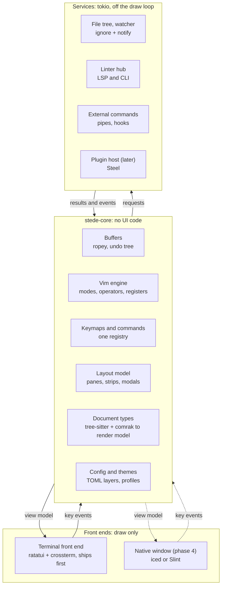
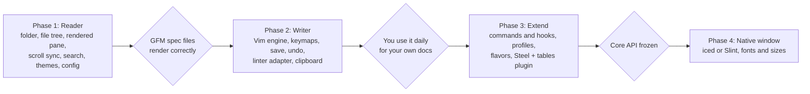

# STEDE.md: Architecture & Tech Stack

Nov 22, 2026 · @Joshua Ogden

## Summary

Build STEDE.md in Rust as a headless editor core with a terminal front end first, and keep the door open for a native GPU front end later. The core owns the text, the parse tree, modes, keymaps, config and linting; front ends only draw and pass input back.

- **Language:** Rust. One static binary per platform, no runtime, strong TUI and Markdown crates, and the same code can later drive a GPU window.
- **TUI:** ratatui on crossterm. Works in every terminal on macOS, Linux and WSL.
- **Text:** a rope buffer (ropey) for edits, tree-sitter Markdown for fast highlighting of the raw pane, comrak for a full GitHub-grade parse that feeds the rendered pane.
- **Linting:** bring your own. A generic adapter runs any CLI or LSP server; rumdl ships as the default because it is a single Rust binary that knows GFM, MkDocs, MDX, Quarto and MyST.
- **Config:** one TOML file plus per-project overrides; keymaps, themes, flavors and linters are all data, not code.
- **Plugins:** later. External commands and hooks first, then plugins written in Scheme (Steel).

One hard limit shapes the plan: a terminal app cannot set its own font or font size. The terminal owns those. The core-plus-front-ends split is how we meet that need without giving up the terminal.

**License:** GPLv3 or later. Every dependency in the plan is permissive or weak copyleft and works under GPLv3; CI blocks any new one that does not (see License).

## Requirements recap

The first release is a fast Markdown reader and writer for AI workflows; the design must not block narrative, script and technical writing later.

| Area | Must have | Later |
| --- | --- | --- |
| Platforms | macOS, Linux, WSL; no Electron or web view | Native window on all three |
| Layout | Raw and rendered side by side; focus one, hide the other | Split by heading, outline pane |
| Panes | Each pane folds to a thin strip at its edge; click or key to open it again | Saved layouts per project |
| Files | File tree pane, folds like the others | Search across files, Git status |
| Editing | Vim modes: insert, delete, yank, paste, motions, `/` search, move between panes | Macros, registers, text objects for Markdown blocks |
| Keys | Vim defaults, every binding remappable | Emacs and plain presets |
| Look | Dark by default; colors, font, font size | Theme files others can share |
| Markdown | Pick a flavor (GFM first) | MyST, MDX, Pandoc, Fountain for scripts |
| Linting | Plug in your own linter | One-key fixes, lint on save |
| Growth | Clean seams for plugins | Plugin API, project types |

The layout rows ask for a pane that folds to the edge rather than closing. That shapes the layout model below.

## What a terminal can and cannot do

A terminal app draws into a grid of same-size cells; the terminal, not the app, picks the font and its size. That clashes with two asks (font and font size) and limits the rendered view. Here is what we can and cannot get.

| Need | In a terminal | How |
| --- | --- | --- |
| Colors, bold, italic, underline, strike | Yes, everywhere | Truecolor with 256-color fallback |
| Font face | No | The user sets it in the terminal; we document it |
| Base font size | No | Same; the terminal's zoom keys still work |
| Bigger headings in the rendered pane | Some terminals | kitty's text sizing protocol (OSC 66), added in kitty 0.40; foot supports it too. Others fall back to bold and color |
| Images | Most modern terminals | ratatui-image speaks kitty, Sixel and iTerm2, with Unicode half-blocks as a fallback |
| Mouse clicks on pane strips | Yes | crossterm mouse events |
| Smooth scroll, real tables with wrapped cells | Partly | We lay tables out ourselves; scroll is by line |

So the plan is two front ends on one core:

1. **Terminal front end first.** It meets every need but font and size, runs over SSH and inside WSL, and starts in milliseconds.
2. **Native window later.** A GPU-drawn window (no web view) adds real fonts, sizes, smooth scroll and inline diagrams. It reuses the same core, keymaps and config, so the `font` and `font_size` settings live in the config from day one and the terminal front end simply ignores them.

The config should say this plainly: settings a front end cannot honor show a short note, not a silent no-op.

## Options weighed

Rust wins because it is the only choice that is fast, ships as one file, has every editor part we need, and can later drive a native window from the same code.

| Option | Speed | Ships as | Parts on hand | Native window later | Verdict |
| --- | --- | --- | --- | --- | --- |
| **Rust + ratatui** | Native | One static binary | Rope, tree-sitter, comrak, images, LSP types | Yes: iced, egui, GPUI share the core | **Pick** |
| Go + Bubble Tea v2 | Native, GC pauses | One static binary | Glamour renders Markdown; editing parts thinner | Weak: Gio only | Runner-up |
| Python + Textual | Slow on large files | Needs a Python runtime | Built-in Markdown widget | Textual Web is a browser, so no | Prototype only |
| Zig or C (libvaxis, notcurses) | Native | One binary | Few parts; we write most | Hard | No |
| Native GUI first (iced, GPUI, Slint) | Native, GPU | One binary | Real fonts | It is the window | Phase 3, not first |
| Tauri, Electron, Wails | Web view | Bundle | Web Markdown tools | Is the web view | Ruled out |

Notes behind the verdicts:

- **Bubble Tea v2** is a real contender. [Charm shipped v2 of Bubble Tea, Lip Gloss and Bubbles on 23 February 2026](https://charm.land/blog/v2/) with a new renderer. Go loses on the second front end, not on the TUI.
- **Tauri** is out for the reason you gave. On Linux it draws through WebKitGTK, and [Tauri's own docs list blank windows, flicker and crashes on resize](https://v2.tauri.app/develop/debug/linux-graphics/), most often on NVIDIA.
- **GPUI** (Zed's toolkit) draws text best, but its crates.io release has sat at 0.2.2 since October 2025 and several forks now compete, so it is risky to bet on today.
- **iced** has a `text_editor` widget and a `markdown` widget, and System76 builds the COSMIC desktop on it. It is the likely pick for phase 4, which waits until the terminal version has proved itself. Under GPLv3, Slint also becomes an option, since it offers its toolkit under GPLv3 for open source apps.

## Recommended stack

Every pick below is a maintained Rust crate; the only parts we write from scratch are the Vim engine, the layout model and the glue. The app is STEDE.md. Below, `stede` is the short name for the binary, the crates and the config paths.

| Concern | Pick | License | Why | Fallback |
| --- | --- | --- | --- | --- |
| Terminal I/O | crossterm | MIT | Same code on macOS, Linux and WSL; mouse, paste, kitty keyboard flags | termion (Unix only) |
| Drawing and layout | [ratatui](https://ratatui.rs/highlights/v030/) 0.30 | MIT | Most used Rust TUI kit; 0.30 split it into smaller crates | Write to crossterm by hand |
| Text buffer | ropey | MIT | Rope: cheap edits and line lookups in large files; Helix uses it | `String` per line |
| Raw pane highlighting | tree-sitter + [tree-sitter-md](https://docs.rs/tree-sitter-md) | MIT | Incremental; separate block and inline grammars; injections color code blocks by language | Regex highlighter |
| Full parse for the rendered pane | [comrak](https://lib.rs/crates/comrak) | BSD-2-Clause | Passes all 652 CommonMark and 670 GFM spec tests; gives source positions so the two panes can scroll together | pulldown-cmark (MIT) |
| Code blocks in the rendered pane | syntect | MIT; bundled syntax files need an audit | Sublime syntaxes and themes, no extra grammars to ship | tree-sitter-highlight (MIT) |
| Images | [ratatui-image](https://docs.rs/crate/ratatui-image/latest), with icy\_sixel | MIT; Apache-2.0 | kitty, Sixel, iTerm2 and half-block fallback in one widget | Show alt text |
| Fold animation and fades | Own easing code; tachyonfx for color fades | Ours; tachyonfx to be checked | Width animation is a few lines; tachyonfx adds effects built for ratatui | No animation |
| File tree | `ignore` + `notify` | MIT or Unlicense; CC0-1.0 (newer notify code also Artistic-2.0) | Respects `.gitignore` (from ripgrep); watches for changes on disk | `walkdir` |
| Fuzzy file open | nucleo | MPL-2.0 | Helix's matcher; fast on big trees | `fuzzy-matcher` (MIT) |
| Search | `regex` | MIT or Apache-2.0 | `/` and `?` in the buffer; project search later via `grep-searcher` | Plain substring |
| Config | `serde` + `toml` | MIT or Apache-2.0 | Readable, typed, easy to merge in layers | KDL |
| Templates | minijinja | Apache-2.0 | Jinja syntax, small; written by the author of Jinja2 | Plain `{{var}}` swaps |
| Linters and LSP | `lsp-types` + a small JSON-RPC client | MIT | One client covers rumdl, marksman, Vale and others | Run CLIs and parse output |
| Background work | tokio | MIT | Child processes, LSP, file watching off the draw loop | Threads and channels |
| Clipboard | arboard + OSC 52 | MIT or Apache-2.0 | arboard for local desktops; OSC 52 works over SSH, in tmux and in Windows Terminal | Internal registers only |
| Plugins (later) | [Steel](https://lib.rs/crates/steel-parser) | MIT or Apache-2.0 | Scheme dialect written in Rust; we expose only the functions we choose | Extism, WASM (BSD-3-Clause) |
| Tests | `insta` + ratatui `TestBackend` | Apache-2.0 | Snapshot each screen; catches layout slips | Manual checks |

We will not build on [edtui](https://docs.rs/crate/edtui/latest), the Vim widget for ratatui. It ties editing to one widget, and we need the Vim engine in the core so the native window can reuse it. It is still a good reference.

## Architecture

The core never imports a UI crate. A front end turns key presses into events, hands them to the core, and draws the view model it gets back. That is why a native window later costs one new crate, not a rewrite.



**One loop.** Input arrives, the core maps it to actions, the actions change state, and the core hands out a fresh view model: panes and their sizes, styled lines, cursor, diagnostics. The front end draws only when something changed. Linter results, file changes and parse results arrive on a channel and wake the loop, so slow work never blocks typing.

**Crates in the workspace**

| Crate | Holds | Depends on UI? |
| --- | --- | --- |
| `stede-core` | Buffers, Vim engine, keymaps, commands, layout model, config | No |
| `stede-markdown` | The Markdown document type: both parsers, render model, outline | No |
| `stede-services` | File tree, watcher, linter hub, external commands | No |
| `stede-tui` | The binary: ratatui drawing, crossterm input, images | Yes |
| `stede-gui` (later) | The native window | Yes |
| `stede-plugin` (later) | Steel host and the plugin API | No |

Keeping UI crates out of the first three is a rule CI can check, which stops the core from drifting toward the terminal.

## Layout and folding panes

The screen is a row of panes: raw, rendered and file tree, in an order you set. A pane is open, folded to a strip at its edge, or turned off. Nothing closes for good; a folded pane is one click or one key from coming back.

```text
Default
+----------------------+--------------------------+------------+
| Raw Markdown         | Rendered                 | Files      |
| Vim keys; focus here | scrolls with the raw pane| right side |
+----------------------+--------------------------+------------+

Writing focus (<leader>z in the raw pane)
+--------------------------------------------------------+-+-+
| Raw Markdown                                           |R|F|
| full width for writing                                 |e|i|
+--------------------------------------------------------+-+-+

Reading focus (<leader>z in the rendered pane)
+-+------------------------------------------------------+-+
|R| Rendered                                             |F|
|a| full width for reading                               |i|
+-+------------------------------------------------------+-+

Strip: click it or press its key to open the pane again.
```

**Rules**

- **Fold direction.** A pane folds toward the screen edge on its side. With the default order, raw folds left, rendered and files fold right.
- **Strips carry status.** A strip shows the pane's name plus small badges: lint count, unsaved dot, search hits.
- **Keys.** `<leader>e` toggles files, `<leader>p` toggles rendered, `<leader>z` folds everything but the pane you are in, and pressing it again restores the last layout. `Ctrl-w h/l` moves focus, and moving into a strip opens it.
- **Mouse.** Click a strip to open it; drag a divider to resize. Widths are saved per project.
- **Narrow terminals.** Below a width you set, rendered folds on its own; narrower still, one pane shows at a time and the strips act as tabs.
- **Files on the right.** As asked. `tree_side = "left"` moves it.

**A file or a folder.** Open a folder and the tree shows it. Open a single file with no folder, and the tree starts folded to its strip; expand it and it shows that file's folder. A `.stede/` folder above the file still applies, if there is one.

**Folding with a snap.** Dragging a divider should feel like closing a drawer, not resizing a box:

1. Drag a divider toward the edge. The pane shrinks with the mouse until it reaches its minimum width (12 columns by default).
2. Past that point it lets go: the pane snaps shut to its strip in about 140 ms with an ease-out curve, and the pane beside it widens in the same motion.
3. The strip lands one column past its rest width and settles back, a small bounce you can see even on a cell grid, and flashes the accent color, then fades over about 200 ms.
4. Drag outward from a strip by 4 columns or more and it springs open to its last width the same way.
5. A few columns of slack around the threshold stop it from flickering open and shut while your hand hovers.

Keyboard folds (`<leader>p`, `<leader>z`) use the same motion, so the mouse and the keys feel alike. Frames only draw while something moves, and each frame goes out as one synchronized update so the terminal never shows half a frame. Animation can be tuned or turned off, which helps on slow SSH links:

```toml
[ui.animation]
enabled       = true
fold_ms       = 140
bounce        = 1      # columns of overshoot; 0 for none
flash         = true
min_width     = 12
```

The layout model is a tree of splits under the hood, even though v1 only uses one row. That leaves room for an outline pane, a second file side by side, or a stacked split later, with no change to how folding works.

## Modals for input and output

Every prompt and every result list opens in a modal over the editor, and one key closes any of them: `Esc` by default, remappable. The panes stay as they were underneath, and focus goes back to where you were when the modal closes.

| Kind | Used for | Keys inside |
| --- | --- | --- |
| Input | New file or folder, rename, save as, `:map` | Type, Enter to confirm, close key to cancel |
| Confirm | Delete, overwrite, a path outside the folder | `y` or Enter yes, `n` no, close key cancels |
| Picker | Fuzzy file open, quick fixes, profiles, themes | Type to filter, `j k` or arrows, Enter to choose |
| Output | `:lint`, `:keys` cheat sheet, external command output, errors | `j k` to move, `/` to filter, Enter to jump (a lint row goes to its line), `y` to copy |

- **One close key everywhere.** It is set once and applies to every modal. Typing `:` commands still happens on the bottom line, but any command that returns a list or text shows it in an output modal.
- **Vim keys in inputs (optional).** With `vim_in_inputs = true`, the first `Esc` drops to Normal mode inside the prompt so you can use `b`, `w`, `ciw`; the second `Esc` closes it.
- **Stacking.** A modal can open another (the cheat sheet from inside a picker, say). The close key shuts the top one only; `close_all` shuts them all.
- **Output stays reachable.** The last output modal can be reopened with `<leader>o`, so you do not lose a lint list or command output by closing it.
- **Size and place.** Modals are centered and sized to their content, up to a share of the screen you set. Long output scrolls.

The modal stack lives in the core's layout model, next to the panes, so the native window draws the same modals with the same keys.

```toml
[keys.modal]
close     = "<Esc>"
close_all = "<C-c>"

[keys.normal]
"<leader>o" = "modal.reopen_last"

[modal]
vim_in_inputs = false
max_width     = "80%"
max_height    = "70%"
```

## Vim-style editing and custom keys

Every key press maps to a named action, and keymaps are plain data. That one rule gives Vim defaults, full remapping, other presets, and plugin commands without special cases.

**How it works**

1. The front end turns a key press into a key event and hands it to the core.
2. The keymap resolver looks it up by mode and by which pane has focus. It handles counts (`3dd`), multi-key sequences (`gg`, `<leader>p`) and a timeout for ambiguous ones.
3. The match is an action name such as `edit.delete_line` or `pane.focus_right`, with optional arguments.
4. The command registry runs it. Built-in actions, user macros and, later, plugin commands all live in the same registry.

**Modes and what ships in v1**

| Mode | Keys in v1 |
| --- | --- |
| Normal | `h j k l w b e 0 $ gg G f t %`, counts, `u`, `Ctrl-r`, `.` repeat |
| Operators | `d y c p P >` `<` with any motion or text object |
| Text objects | ` iw aw ip ap i" i(  ` plus Markdown ones: `ih` heading section, `il` list item, `ic` code block, `it` table cell |
| Insert | Typing, `Ctrl-w`, `Ctrl-u`, smart list continue on Enter |
| Visual | `v V Ctrl-v`, then any operator |
| Search | `/` and `?`, `n N * #`, regex with smart case, all matches lit |
| Command | `:w :q :e :set :map :lint :fmt`, history |
| Tree pane | `j k`, `l` or Enter to open, `h` to close, `a` add file or folder (see below), t new from template, `r` rename, `d` delete, `/` filter |
| Panes | `Ctrl-w h/l` and `Ctrl-h/l` to move focus, `<leader>p` preview, `<leader>e` tree, `<leader>z` focus one |

**Adding files and folders in the tree**

`a` opens an input modal (see Modals). What you type decides what gets made, so one key covers files, folders and nested paths:

| You type | Result |
| --- | --- |
| `notes.md` | New file `notes.md` |
| `drafts/` | New folder `drafts` (a trailing `/` means folder) |
| `newfolder/newfile.txt` | Folder `newfolder`, then the file inside it, in one step |
| `a/b/c/` | All three folders, nested |
| `a/b/notes.md` | Folders `a` and `b`, then the file |

- **Where it lands:** paths are relative to the selected folder, or to the folder holding the selected file. The prompt shows that base so there is no guessing.
- **Missing folders:** any folder in the path that does not exist yet is created, as `mkdir -p` would. Folders that already exist are reused.
- **After it is made:** a new file opens in the raw pane; a new folder is expanded and selected in the tree.
- **No overwrites:** if the final file or folder already exists, nothing changes and the prompt says so.
- **Bad names:** names the file system rejects show an error in the prompt and create nothing. This matters in WSL, where Windows drives refuse names with `:`, `?` or `*`. A path that leads outside the open folder asks first.
- **Templates (optional):** a new `.md` file can start from the folder's default template, or press t in the tree to pick one (see Templates under Config).

Registers work as in Vim: unnamed, `a`–`z`, `+` for the system clipboard, `_` to discard. Undo is a tree, saved per file so it survives a restart.

**Line numbers**

The raw pane has a line number column you can turn on or off. It has four modes, so the numbers match how you move:

| Mode | What the column shows | Good for |
| --- | --- | --- |
| `off` | Nothing | Most room for text |
| `absolute` | 1, 2, 3 from the top of the file | Matching line numbers from linters and `:42` jumps |
| `relative` | Distance from the cursor line, counting up above it and down below it; the cursor line shows 0 | Counted moves: `5k` goes up 5, `3j` down 3, `d4j` deletes 5 lines |
| `hybrid` | Relative numbers, but the cursor line shows its real line number | Both at once; this is Vim's `number` + `relativenumber` |

Details:

- **Counts match the column.** Relative numbers count real lines in the file, not wrapped screen rows, so the number you read is the count `j` and `k` need. If you turn on `wrap_moves = true`, `j` and `k` move by screen row and the column numbers screen rows to match.
- **Toggle fast.** `<leader>n` cycles through the modes; `:set number`, `:set relativenumber` and `:set nonumber` work as in Vim.
- **Insert mode.** Optional `absolute_in_insert = true` shows plain numbers while you type and switches back to relative in Normal mode.
- **Look.** The cursor line's number uses its own theme slot (`ui.linenr.current`) so it stands out; the column width grows with the file's line count.

```toml
[editor.line_numbers]
mode               = "hybrid"   # off | absolute | relative | hybrid
absolute_in_insert = false
wrap_moves         = false
```

**Key cheat sheet**

One key opens a modal over the editor that lists every key binding in force right now. It is built from the live keymap, not a static help page, so your remaps, presets, custom commands and, later, plugin keys all show up.

- **Default key:** `<leader>?`. Plain `?` stays as Vim's backward search. `F1` opens it too. Both can be changed.
- **Layout:** one tab per mode (Normal, Insert, Visual, Command, Tree, Panes). It opens on the tab for the mode and pane you are in.
- **Each row:** the keys, the action name, and a one-line description. Every built-in action has one; your own commands take a `desc` field.
- **Find:** start typing to filter by key, action or description (fuzzy).
- **Your changes stand out:** bindings you changed or added are marked, and bindings that clash with one another are flagged.
- **Act from it:** Enter runs the selected action; `Esc` (the modal close key) or the same hotkey closes it.
- **Prefix hints (optional):** press a prefix such as `<leader>` or `g` and pause, and a small popup lists the keys that can follow. Off by default.

```toml
[keys.normal]
"<leader>?" = "help.keys"
"<F1>"      = "help.keys"

[help]
prefix_hints   = false
hint_delay_ms  = 400

[[commands]]
name = "ai.tighten"
desc = "Send the selection to an AI CLI and replace it"
```

`:keys` opens the same sheet, and the native window will reuse it, because the core builds the list and the front end only draws it.

**Remapping in config**

```toml
[keys]
leader = "space"
preset = "vim"            # or "plain" for non-modal editing

[keys.normal]
"<leader>p" = "pane.toggle preview"
"gl"        = "link.follow"
"<C-s>"     = "file.save"

[keys.tree]
"o" = "tree.open_split"
```

At load we report conflicts and unknown actions by line number. `:keys` opens the key cheat sheet (above), and `:map` adds one for the session. A `plain` preset (arrow keys, Ctrl shortcuts, no modes) costs little because it is just another table.

## Markdown flavors and the rendered view

A flavor is a named profile, not code: it sets parser switches, picks linters, and tweaks how the rendered pane draws things. GFM is the default.

| Order | Flavor | Parser switches (comrak) | Ships in |
| --- | --- | --- | --- |
| 1 | GFM (default) | Tables, task lists, strikethrough, autolinks, footnotes, alerts, front matter | v1 |
| 2 | CommonMark | None | v1 |
| 3 | Obsidian-style notes | GFM + wikilinks + math | v1.x |
| 4 | MkDocs | GFM + admonitions and other MkDocs blocks, matched by rumdl's `mkdocs` flavor | v1.x |
| Later | MyST, Quarto, Pandoc | GFM + their block syntax | When asked for |
| Later | Fountain (scripts) | Its own parser: not Markdown, a separate document type | With document types |

A project sets its flavor in `.stede/config.toml`; a file can override it in front matter (`stede.flavor: myst`).

**Two parsers, two jobs**

- **tree-sitter-md** runs on every keystroke and only reparses what changed. It colors the raw pane and powers Markdown text objects and the outline.
- **comrak** runs on a worker thread after a short pause in typing. It builds the full tree with source positions and feeds the rendered pane. For files of normal size a full reparse is cheap; if huge files lag, we reparse only the top-level blocks that changed.

The core turns comrak's tree into a **render model**: blocks with style tokens (`Heading(2)`, `Code(lang)`, `Alert(Warning)`) and the source lines each came from. The front end decides what a token looks like. That is what lets the native window reuse it, and what keeps the two panes scrolled together.

**What the rendered pane draws in a terminal**

- Headings in color and bold; larger text where the terminal supports kitty's text sizing.
- Lists with real bullets and numbers; task boxes as ☐ and ☑.
- Tables drawn with box lines, cells wrapped to fit the pane.
- Code blocks on a tinted band, colored by language, with a key to copy the block.
- Block quotes and GFM alerts with a colored bar and label.
- Links underlined; `gl` follows a link, including links to other local files.
- Images inline where the terminal can show them, else alt text.
- Front matter as a small folded table.
- Mermaid and other diagram blocks: source by default; optionally piped to an external renderer you name, and shown as an image.

**The rendered pane is read-only.** You write in the raw pane only; that keeps the render model one-way and simple. The rendered pane still takes keys: `j k` and search scroll it, `gl` follows links, `y` on a code block copies it, and Enter on any block jumps the raw pane's cursor to that block's source line.

**Room to grow.** Markdown is the first **document type**. A document type supplies a parser, a render model, an outline and default linters. Fountain for scripts, or a long-form project that stitches many files into chapters, plug in at that seam without touching the editor.

## Linting: bring your own

We build no lint rules. We build one adapter that can drive any linter, and we suggest rumdl as the default. Your hunch was right: owning rules per flavor is a trap, while an adapter serves every flavor and every team's house style.

**Two kinds of adapter**

- **LSP** (preferred). The linter runs as a language server; we get live diagnostics, quick fixes and formatting through one protocol. [rumdl ships one](https://docs.rs/crate/rumdl/0.2.3/source/docs/lsp.md) (`rumdl server`), and marksman adds links, rename and go-to-heading for Markdown.
- **CLI.** For tools with no server: we run a command on save or on idle and read its output as JSON, SARIF, or a pattern you give, like Vim's `errorformat`. This covers Vale for prose style and any script you write.

**Config**

```toml
[[linters]]
name    = "rumdl"
kind    = "lsp"
command = ["rumdl", "server"]
flavors = ["gfm", "mkdocs", "myst"]

[[linters]]
name    = "vale"
kind    = "cli"
command = ["vale", "--output=JSON", "{file}"]
format  = "vale-json"
run_on  = ["save"]

[format]
on_save = true
with    = "rumdl"
```

**Why rumdl as the default.** It is one Rust binary with no runtime, it reads markdownlint config, and it knows [GFM, MkDocs, MDX, Quarto and MyST](https://docs.rs/crate/rumdl/0.3.1). We detect it on `PATH` and offer to turn it on; we do not bundle it, so users pick their version.

**In the editor.** Diagnostics show as a sign in the gutter, an underline in the raw pane, and a count on the pane's strip when folded. `]d` and `[d` jump between them, `<leader>a` lists quick fixes, and `:lint` opens the full list in an output modal. Several linters can run at once, and each message names the linter that raised it.

## Config and theming

One TOML file holds everything, merged in layers so a project or a writing mode can change only what it needs.

**Layers, last wins**

1. Built-in defaults (dark theme, Vim keys, GFM).
2. User file: `~/.config/stede/config.toml` on all three systems, honoring `XDG_CONFIG_HOME`.
3. Project folder: `.stede/config.toml`, found by walking up from the open folder, then .stede/local.toml for your own overrides.
4. A named profile, picked by the project or by `:profile`.
5. Session changes from `:set`.

Saving the file reloads it live. Errors show the file, line and key, and the last good config stays in force.

**The project folder: `.stede/`**

A project keeps everything the editor needs in one hidden folder at its root, not a single config file. Config, templates and editor state live side by side, and new kinds of project data get a home there without new dotfiles.

```
my-project/
  .stede/
    config.toml      # project settings; same keys as the user file
    templates/       # file and folder templates for this project
      prompt.md
      adr.md
      chapter/       # a folder template: makes several files at once
    themes/          # optional project themes
    local.toml       # your personal overrides; not committed
    state/           # pane widths, sessions, undo history; not committed
    .gitignore       # written by :init; ignores local.toml and state/
    plugins/         # later
```

- **Finding it.** The editor walks up from the open folder to the nearest `.stede/`; the folder that holds it is the project root.
- **What to commit.** `config.toml`, `templates/` and `themes/` are meant to be shared with a team. `local.toml` and `state/` are personal, and `:init` writes a `.gitignore` inside `.stede/` to keep them out.
- **Same shape at the user level.** `~/.config/stede/` uses the same layout, so themes and templates can live in either place. A project item shadows a user item of the same name.
- **Getting started.** `:init` creates `.stede/` with a commented `config.toml` and two starter templates. Nothing is created until you ask.
- **Room to grow.** Snippets, saved layouts, plugin data and per-project dictionaries go in new subfolders here; the rule is that anything shared sits outside `state/` and anything personal sits inside it.

**Templates**

A template is a file in a `templates/` folder. It can be any text file; Markdown is the common case. You create files from templates in the tree, from a command, or automatically by folder.

*What a template looks like.* An optional `+++` block at the top holds the template's own settings and is dropped from the output. Everything after it, including normal YAML front matter, becomes the new file.

```markdown
+++
name        = "AI prompt"
description = "Prompt file with context, task and output sections"
filename    = "{{ date }}-{{ title | slug }}.md"
folders     = ["prompts/"]
+++
---
title: {{ title }}
created: {{ date }}
model: {{ ask("Model", default="claude") }}
---

# {{ title }}

## Context

{{ cursor }}

## Task

## Output format
```

*Placeholders.* Templates use Jinja syntax through the minijinja crate, so conditions and loops work when needed. Built in: `title`, `date` and `time` (with an optional format), `file.name`, `file.dir`, `project.name`, `user.name`, `ask("Label")` which opens an input modal for a value, and `cursor`, which marks where the cursor lands. Projects can add their own fixed values under `[templates.vars]`.

*Folder templates.* A folder inside `templates/` makes all of its files at once, with placeholders allowed in file names too. A `chapter/` template can make `chapter.md` and `notes.md` in a new folder named after the chapter.

*Ways to use them.*

1. **Tree, `t`:** a picker modal lists templates for the selected folder, with a preview. Pick one, then the name prompt opens, pre-filled from the template's `filename` pattern. Paths work as with `a`, so `drafts/new-idea` makes the folder too.
2. **Command:** `:new adr` or `:new adr decisions/use-rust.md`.
3. **By folder:** set a default, and `a` in that folder uses it for new `.md` files. `a` with `!` at the end of the name skips the template.
4. **Into the current file:** `:insert-template` drops a template's body at the cursor, for repeated blocks.

```toml
# .stede/config.toml
[templates.defaults]
"prompts/"   = "prompt"
"decisions/" = "adr"

[templates.vars]
team = "Docs"
```

**Profiles** are how one install serves many ways of writing. A profile is a bundle of overrides:

```toml
theme  = "stede-dark"
flavor = "gfm"

[layout]
panes      = ["raw", "preview", "tree"]   # order, left to right
tree_side  = "right"
preview    = { width = "45%", max_text_width = 88 }

[gui]                 # used by the native window; the terminal shows a note
font      = "JetBrains Mono"
font_size = 14

[profile.ai-prompts]
flavor  = "gfm"
layout  = { panes = ["raw", "preview"] }
status  = ["words", "tokens", "lint"]

[profile.screenplay]
doctype = "fountain"
theme   = "paper-dark"
layout  = { panes = ["raw", "outline"] }
```

**Themes** are their own TOML files in `~/.config/stede/themes/`. A theme sets a small palette, then maps meaning to color: `ui.background`, `ui.strip`, `md.heading.1` to `md.heading.6`, `md.code.bg`, `md.link`, `diag.warning` and so on. The front end maps those slots to what it can show: truecolor where the terminal says it has it, else the nearest of 256 or 16 colors. We ship four: dark (default), light, high contrast, and a warm dark for long reading.

**Other knobs on day one:** text width in the rendered pane, bullet and heading glyphs, images on or off, Nerd Font icons in the tree (off by default, since many fonts lack them), line number mode (see the Vim section), wrap, and which items show in the status line.

## Extensibility and plugins

Plugins come last, but the seams for them go in first: the command registry, the document-type trait and the linter adapter are the same hooks a plugin will use. We add power in three steps, each useful alone.

| Step | What users can do | Cost to us | When |
| --- | --- | --- | --- |
| 1. Data | Keymaps, themes, flavors, profiles, linters, templates | Low; it is config | v1 |
| 2. External commands | Pipe the file or a selection to any shell command and insert, replace or show the result; run hooks on open and save | Low; one runner | v1.x |
| 3. Scheme plugins | Add commands and keys, react to events, read and edit buffers, add document types and render blocks, add a pane | High; a stable API we must keep | Later |

**Step 2 does most of the AI work.** A command such as `:'<,'>!llm "tighten this"` or a named action bound to a key sends the selection to whichever AI CLI you use and puts the reply back. No AI vendor lives in the core.

```toml
[[commands]]
name   = "ai.tighten"
run    = ["llm", "-s", "Tighten this prose"]
input  = "selection"
output = "replace"
key    = "<leader>at"
```

**Step 3 in Scheme.** A Lisp suits an editor: config, keymaps and commands can all be data the plugin builds and hands back, and Emacs has shown how far that goes. Four ways to embed one:

| Option | What it is | License | Fit |
| --- | --- | --- | --- |
| [Steel](https://lib.rs/crates/steel-parser) | Scheme written in Rust; bytecode VM, mostly R5RS | MIT or Apache-2.0 | **Explore first.** Pure Rust, so it builds wherever we do. Helix's draft plugin system uses it, so some Vim-style users will know it |
| Guile | GNU's Scheme, a C library | LGPLv3 or later | Most mature Scheme and GNU's own extension language; costs a C build on macOS and in WSL |
| Janet | Small Lisp in C, made for embedding | MIT | Tiny and fast, but not Scheme and a smaller community |
| Fennel on Lua (mlua) | Lisp syntax that compiles to Lua | MIT | Mature runtime, but two languages in the stack |

**How a plugin looks** (a sketch; the API is not designed yet):

```scheme
;; .stede/plugins/word-goal.scm
(require "stede/api")

(define goal 1500)

(define-command "goal.show" "Words written against the goal"
  (lambda ()
    (notify (format "~a / ~a words" (word-count (current-buffer)) goal))))

(on 'buffer-save
  (lambda (buf)
    (when (< (word-count buf) goal)
      (notify (format "~a words to go" (- goal (word-count buf)))))))
```

**Safety.** Steel has no sandbox of its own that we found, so the safety comes from what we expose. A plugin sees only the functions we register. File, process and network access come as separate grants that the plugin's manifest asks for and the user approves once. The spike should also check that a stuck plugin can be stopped without freezing the editor. If Steel falls short there, WASM through Extism stays the fallback, since it sandboxes by design.

**Decided: Steel.** The other three options stay in the table above as the record of what we weighed.

### First plugin: tables

The first Steel plugin is a table builder, written as soon as phase 2 ships. It is small enough to finish quickly, and it touches most of the plugin API: commands, keys, an input form, reading and editing the buffer, and the syntax tree. Whatever it needs, the API must offer.

**What GFM lets a table control**, so the tool covers all of it:

| Part | What Markdown allows | What the tool offers |
| --- | --- | --- |
| Size | Any number of columns; a header row plus any number of body rows | Rows × columns at creation; add, delete and move rows and columns later |
| Header row | Required in GFM; cells may be empty | Header text per column, or blank headers |
| Alignment | Per column: left `:---`, center `:---:`, right `---:`, or none `---` | Set per column when creating; change the current column any time |
| Cell content | Inline Markdown only: emphasis, code, links, images; `\|` for a literal pipe | Escapes pipes as you type; `<br>` for a line break, if you allow HTML |
| Outer pipes | Optional at the start and end of each row | A style choice: on or off |
| Spacing | Free; padding does not change the output | Padded so columns line up, or compact |
| Things GFM lacks | No merged cells, captions or multi-line cells | Not faked; a caption can go in a line above or below the table if you want one |

**Creating a table.** `:table`, or `<leader>tt`, opens an input form in a modal with a live preview:

- Rows and columns, typed as `3x4`.
- Alignment per column as letters, such as `l c r r` (`-` for none).
- Header text, comma separated, or leave blank.
- Style: padded or compact, outer pipes on or off.

A quick form skips the modal: `:table 3x4 l c r r` puts the table at the cursor with the cursor in the first header cell.

**Editing a table** (the cursor anywhere inside one):

| Keys | Action |
| --- | --- |
| `Tab` / `Shift-Tab` in Insert mode | Next or previous cell; `Tab` in the last cell adds a row |
| `<leader>tf` | Re-pad every column so the table lines up again |
| `<leader>tr` / `<leader>tR` | Add a row below / above |
| `<leader>tc` / `<leader>tC` | Add a column right / left |
| `<leader>td` / `<leader>tD` | Delete the current row / column |
| `<leader>ta` | Cycle the current column's alignment |
| `<leader>ts` | Sort rows by the current column |
| `<leader>tm` | Move the current row or column (then `h j k l`) |
| `:table-from-csv` / `:table-to-csv` | Convert a selected CSV or TSV block, or the table back to CSV |

All of these appear in the key cheat sheet, and every key can be remapped. Padding counts display width, so wide characters such as CJK text and emoji still line up.

**Defaults, per project:**

```toml
# .stede/config.toml
[plugins.tables]
style          = "padded"   # padded | compact
outer_pipes    = true
default_align  = "none"     # none | left | center | right
allow_br       = false      # allow <br> for line breaks in cells
format_on_save = true
```

**Plays well with linting.** rumdl already checks [table pipe style, column count and blank lines around tables](https://docs.rs/crate/rumdl/0.0.12) (rules MD055, MD056 and MD058). The plugin's output should pass those rules with no fixes needed, and that is the plugin's test.

**What it asks of the plugin API:** commands and keymaps, an input form with a preview, the syntax node at the cursor (tree-sitter-md marks tables and cells), read and replace a range of the buffer, a display-width helper, a hook for `Tab` in Insert mode, and a config section. Building this plugin is how we prove that API before others write against it.

## Cross-platform notes

One codebase builds for all three; the work is in a handful of known gaps, each with a planned fix.

| Platform | Gap | Plan |
| --- | --- | --- |
| macOS | Terminal.app has no image protocol and weaker color | Fall back to alt text and 256 colors; suggest Ghostty, kitty, iTerm2 or WezTerm |
| macOS | Alt keys type symbols unless "Option as Meta" is on | Default bindings avoid Alt; docs show the setting |
| macOS | Two chip types | Ship a universal binary (arm64 + x86\_64) |
| Linux | Clipboard needs X11 or Wayland; none over SSH | arboard when a display exists, else OSC 52 |
| Linux | Many distros and libc versions | Static musl builds for x86\_64 and aarch64 |
| WSL | inotify does not fire for files on Windows drives (`/mnt/c`); [it works only on the Linux ext4 side](https://kiwix.lema.org/stackoverflow.com_en_all_2023-11/questions/70273307/how-to-turn-on-inotify-in-wsl2) | Detect `/mnt/*` paths and switch the watcher to polling; tell users ext4 is faster |
| WSL | No kitty graphics in Windows Terminal | Use Sixel, which [Windows Terminal has had since 1.22](https://devblogs.microsoft.com/commandline/?p=10434) |
| WSL | Clipboard lives on the Windows side | OSC 52, which [Windows Terminal supports](https://github.com/microsoft/terminal/issues/2946); `clip.exe` as a fallback |
| WSL | Windows Terminal eats some Ctrl and Alt combos | Test matrix; defaults avoid the known ones |

**Shipping.** cargo-dist builds GitHub releases, a shell installer and a Homebrew tap from one config. A native Windows build comes almost free with crossterm, though it is not a target.

**Test matrix.** Each release runs snapshot tests headless, then a manual pass on: Ghostty and Terminal.app (macOS), kitty, WezTerm and GNOME Terminal (Linux), Windows Terminal with Ubuntu (WSL), and tmux on top of one of each.

## License: GPLv3

Nothing in the stack blocks a GPLv3 release. Every crate we picked is permissive (MIT, BSD, Apache-2.0, CC0) or weak copyleft (MPL-2.0), and all of those are on the [FSF's list of GPL-compatible licenses](https://www.gnu.org/l/license-list.html). The License column in the stack table shows each one. This is a careful reading, not legal advice.

**Choose "GPL-3.0-or-later".** Apache-2.0 code mixes with GPLv3 but not with GPLv2, so v2 is out. "Or later" lets the project move to a future GPL without asking every contributor.

**Items to watch**

| Item | Why it needs a look | What we do |
| --- | --- | --- |
| nucleo (MPL-2.0) | Weak copyleft: its own files stay MPL, and changes to them must be shared under MPL. MPL-2.0 works with the GPL unless a file says it is "Incompatible With Secondary Licenses" | Use it as is; do not patch its files in our tree |
| notify (CC0 + Artistic-2.0) | Two licenses on different parts of the code | Both are on the FSF list; nothing to do |
| syntect's bundled syntax and theme files | They come from many authors under mixed terms | Ship only syntaxes we have checked, built into our own bundle |
| tachyonfx | Not yet checked | Check before adding; easing code alone needs no crate |
| Fonts (phase 4) | Fonts often use the SIL Open Font License | Ship fonts as separate files, never compiled into the binary |
| Plugins | Plugins that call into STEDE.md and share its data are likely one combined program under the GPL | Plugin docs say plugins must use a GPL-compatible license |
| Native window toolkit | iced (MIT) and GPUI (Apache-2.0) are fine | Slint joins the options, under its GPLv3 terms |

Outside tools (rumdl, Vale, marksman, AI CLIs) run as separate processes, so their licenses do not mix with ours.

**Keeping it that way.** `cargo-deny` runs in CI with an allow list: MIT, Apache-2.0 (with or without the LLVM exception), BSD-2-Clause, BSD-3-Clause, ISC, Zlib, Unicode-3.0, CC0-1.0, Unlicense, Artistic-2.0, MPL-2.0, LGPL-3.0-or-later and GPL-3.0-or-later. Any new dependency outside that list fails the build. `cargo-about` writes the third-party notices file shipped with each release, and every source file carries an SPDX header.

## Roadmap

Build the reader first. It exercises the core, both parsers, the layout model and the config without the hardest piece, the Vim engine, and it is useful for reading AI output on day one.



Beyond: new document types on the same core (Fountain scripts, long-form projects, doc sites).

Each diamond is a gate: we do not start the next phase until its test passes. Before phase 1, a short spike should prove the riskiest bits: comrak source positions driving scroll sync, kitty text sizing and Sixel in the target terminals, and keyboard handling inside Windows Terminal.

Phase 3 opens with the first Steel plugin, the table builder (see Extensibility and plugins). It doubles as the test of the plugin API.

## Decisions and open questions

Decided on 22 November 2026. AI hooks wait until later, and two small questions came out of the answers.

| Question | Decision | Where it shows |
| --- | --- | --- |
| Native window timing | Terminal only for now; the native window stays in phase 4 | Roadmap |
| Edit in the rendered pane | No; the rendered pane is read-only | Markdown flavors and the rendered view |
| Folder or file | Both; a single file opens with the tree folded | Layout and folding panes |
| Flavor order | GFM, then CommonMark, Obsidian-style, MkDocs | Markdown flavors and the rendered view |
| Plugin language | Steel. First plugin: a table builder, right after phase 2 | Extensibility and plugins |
| Mouse | The basics, plus folding by drag with a snap | Layout and folding panes |
| Name | STEDE.md; `stede` for the binary, crates and config paths | Throughout |
| License | GPLv3; every dependency checked | License: GPLv3 |

- [ ] **AI hooks (later).** Is piping to an outside CLI enough, or should there be a built-in panel for prompts and replies?
- [ ] **GPL-3.0-only or GPL-3.0-or-later?** The plan assumes "or later".
- [ ] **Short name.** Is `stede` right for the command and folders (`stede notes.md`, `.stede/`)?

## Sources

- [Ratatui 0.30 release notes](https://ratatui.rs/highlights/v030/)
- [kitty text sizing protocol](https://sw.kovidgoyal.net/kitty/text-sizing-protocol/) and [terminal support for OSC 66](https://terminfo-dev.pages.dev/extensions/osc66-text-sizing)
- [ratatui-image](https://docs.rs/crate/ratatui-image/latest)
- [comrak](https://lib.rs/crates/comrak) and [comrak 0.58 docs](https://docs.rs/crate/comrak/0.58.0)
- [tree-sitter-md](https://docs.rs/tree-sitter-md)
- [rumdl](https://docs.rs/crate/rumdl/0.3.1) and [rumdl LSP docs](https://docs.rs/crate/rumdl/0.2.3/source/docs/lsp.md)
- [edtui](https://docs.rs/crate/edtui/latest)
- [Bubble Tea v2 announcement](https://charm.land/blog/v2/)
- [Tauri: Linux graphics issues](https://v2.tauri.app/develop/debug/linux-graphics/)
- [iced 0.14 release](https://github.com/iced-rs/iced/releases/tag/0.14.0)
- [gpui on docs.rs](https://docs.rs/crate/gpui/latest)
- [Extism](https://github.com/extism/extism)
- [Windows Terminal 1.22 stable with Sixel](https://devblogs.microsoft.com/commandline/?p=10434) and [OSC 52 issue](https://github.com/microsoft/terminal/issues/2946)
- [inotify on WSL2 Windows drives](https://kiwix.lema.org/stackoverflow.com_en_all_2023-11/questions/70273307/how-to-turn-on-inotify-in-wsl2)

* [FSF: licenses and GPL compatibility](https://www.gnu.org/l/license-list.html)
* [Steel (Scheme in Rust)](https://lib.rs/crates/steel-parser) and [Helix's draft Steel plugin system](https://github.com/helix-editor/helix/pull/8675)
* [Slint license terms](https://raw.githubusercontent.com/slint-ui/slint/HEAD/LICENSE.md)
* [nucleo license](https://docs.rs/crate/nucleo/0.0.0/source/Cargo.toml)
* [notify license](https://docs.rs/crate/notify/^5.0)
* [icy\_sixel](https://docs.rs/crate/icy_sixel/0.4.3)
